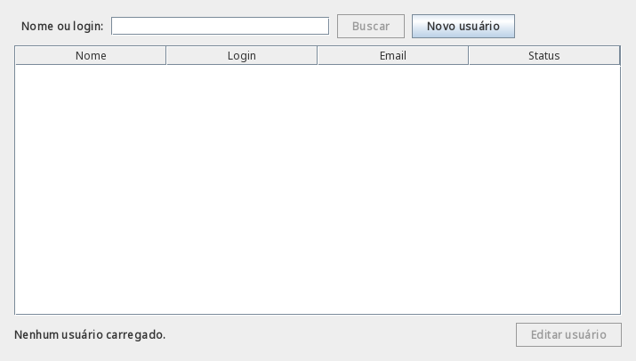
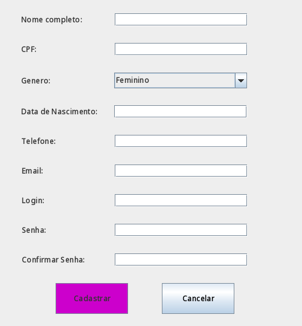
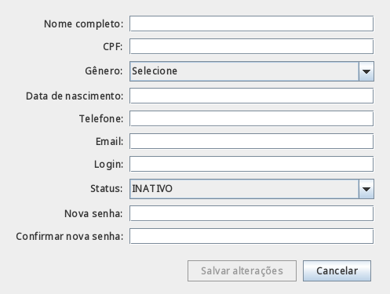

# Atividade 14 - JPA e Hibernate (Parte 1)

O domínio mapeado é `Usuario`, na tabela `usuarios`. A chave `Long id` usa `@Id` e `@GeneratedValue(strategy = GenerationType.IDENTITY)`. Os nomes das colunas são definidos com `@Column`, o login é único e o status usa `@Enumerated(EnumType.STRING)` para gravar `ATIVO` ou `INATIVO`.

Os construtores, a autenticação, os getters/setters e a igualdade por login foram mantidos. `perfilAtivo` e `perfis` usam `@Transient` porque `Perfil` ainda não foi mapeado: continuam funcionando em memória, mas não são gravados pelo JPA nesta etapa. A data de nascimento continua como `String` para manter o contrato das aulas anteriores.

## Arquivos e pacotes

O código executável permanece na estrutura Maven de `src/`; esta pasta reúne a documentação e as evidências da atividade.

- Entidade: [`Usuario.java`](../../src/main/java/br/com/ifba/usuario/entity/Usuario.java), em `br.com.ifba.usuario.entity`.
- Telas: [`TelaListagemUsuario.java`](../../src/main/java/br/com/ifba/usuario/view/TelaListagemUsuario.java), [`TelaCadastroUsuario.java`](../../src/main/java/br/com/ifba/usuario/view/TelaCadastroUsuario.java) e [`TelaEdicaoUsuario.java`](../../src/main/java/br/com/ifba/usuario/view/TelaEdicaoUsuario.java), em `br.com.ifba.usuario.view`.
- Configuração versionada: [`persistence.xml.exemplo`](../../src/main/resources/META-INF/persistence.xml.exemplo).
- Pergunta do DTO: [`RETROSPECTIVA.md`](../../RETROSPECTIVA.md), na raiz.
- Imagem da aplicação: [`logo.png`](../../src/main/resources/br/com/ifba/login/imagens/logo.png). O login carrega a imagem pelo classpath, sem depender de um caminho absoluto. As evidências ficam em `ATIVIDADES/`, na pasta de cada atividade.

## Configuração local do PostgreSQL

As dependências do `pom.xml` são Hibernate ORM 7.4.13.Final e PostgreSQL JDBC 42.7.14. A documentação oficial confirma o suporte a Java 25 do [Hibernate](https://hibernate.org/orm/releases/7.4/) e apresenta o [driver PostgreSQL](https://jdbc.postgresql.org/download/).

```bash
cp src/main/resources/META-INF/persistence.xml.exemplo src/main/resources/META-INF/persistence.xml
```

Preencha `jakarta.persistence.jdbc.url`, `jakarta.persistence.jdbc.user` e `jakarta.persistence.jdbc.password` somente no arquivo local. Exemplo de URL: `jdbc:postgresql://localhost:5432/apexoptima`. O nome da unidade de persistência é `apexoptimaPU`, com transações `RESOURCE_LOCAL`. O banco precisa existir quando a persistência for utilizada.

O arquivo real `persistence.xml` e a pasta `target/` estão ignorados pelo Git. O exemplo mantém URL, usuário e senha em branco. A configuração mostra e formata o SQL; a geração automática de esquema está desativada (`none`). Nenhuma tela abre conexão, cria tabela ou executa operações JPA nesta Parte 1.

## Telas

Execute o `main` de cada classe na IDE para visualizar os componentes:

- Listagem: busca por nome/login, tabela com nome, login, email e status, botão de novo cadastro e componente de edição. A tabela começa vazia; buscar e editar estão desabilitados enquanto a integração não existe.
- Cadastro: reaproveita o formulário das aulas anteriores, com sua validação e repositório em memória. O botão “Novo usuário” da listagem abre esse formulário.
- Edição: formulário de dados pessoais, login, status, nova senha e confirmação; cancelar fecha a janela e salvar está desabilitado. Os campos de senha começam vazios.

A ligação da listagem ao repositório, o carregamento de um usuário na edição e as operações de banco ficam para a Parte 2. Antes de gravar senhas no banco, será necessário substituir o armazenamento atual em texto por um hash adequado e adaptar a autenticação.

## Verificação

```bash
./mvnw clean package
```

Os 35 testes anteriores continuam passando sem alterações. `UsuarioJpaTest` lê `persistence.xml.exemplo`, inicializa a unidade JPA com Hibernate e prepara uma consulta JPQL parametrizada por login e status, sem executar SQL nem depender de credenciais locais. Total: **36 testes, zero falhas, zero erros**. Esse teste valida a configuração e o mapeamento, sem verificar uma conexão PostgreSQL ou operações de persistência.

O resultado completo da compilação e dos testes está em [`verificacao.txt`](verificacao.txt).

As imagens abaixo são renderizações dos componentes Swing reais, com os formulários vazios, conferidas visualmente:






