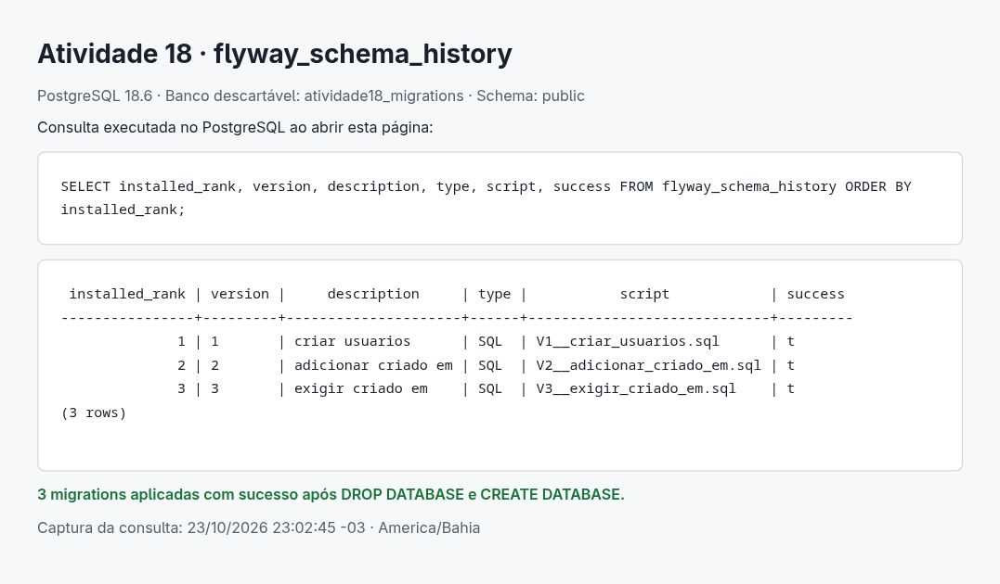

# Atividade 18 - Migrations

O Flyway passa a controlar as alterações do banco do ApexOptima. A entidade principal mapeada é `Usuario`; o SQL das migrations foi escrito a partir dos campos e das regras do domínio.

## Implementação

| Versão | Alteração |
| --- | --- |
| V1 | Cria `usuarios`, com ID `BIGINT` identity, tamanhos e nulabilidade dos campos, login único e status limitado a `ATIVO`/`INATIVO`. |
| V2 | Adiciona `criado_em TIMESTAMP(6) WITH TIME ZONE DEFAULT CURRENT_TIMESTAMP`. O default preenche os registros existentes. |
| V3 | Aplica `NOT NULL` a `criado_em`. |

As migrations ficam em [`src/main/resources/db/migration`](../../src/main/resources/db/migration), conforme a estrutura exigida pelo Flyway. Esta pasta reúne a documentação e as evidências da entrega.

[`BancoDados`](../../src/main/java/br/com/ifba/infra/BancoDados.java) lê a unidade `apexoptimaPU` do `persistence.xml` local e usa as mesmas propriedades JDBC no Flyway e no Hibernate. `migrate()` termina antes da criação do `EntityManagerFactory`. Se a migração ou a validação falhar, a tela de login não abre. O arquivo de exemplo usa `hibernate.hbm2ddl.auto=validate`; a opção anterior `jakarta.persistence.schema-generation.database.action=none` foi removida para deixar a validação a cargo dessa configuração.

[`Usuario.criadoEm`](../../src/main/java/br/com/ifba/usuario/entity/Usuario.java) usa `Instant` e não pode ser atualizado pelo JPA. Os campos anteriores mantêm os tipos e os limites do mapeamento: por exemplo, `data_nascimento` continua `VARCHAR(10)` porque `birthDay` é `String`, e `status` é `VARCHAR(10)` porque usa `EnumType.STRING`. `perfilAtivo` e `perfis` continuam `@Transient`.

Não houve divergência entre as migrations finais e a entidade na inicialização real. Para comprovar que `validate` está ativo, um teste remove a coluna `nome` em um schema isolado: a inicialização falha com `PersistenceException` causada por `SchemaManagementException: missing column [nome]`. O teste confirma que o Hibernate não recria a coluna.

As telas mantêm o repositório em memória das atividades anteriores. Nesta etapa, a inicialização migra e valida o banco; a integração do CRUD Swing com JPA não faz parte desta entrega. O factory usado nessa conferência é fechado antes da abertura da interface.

## Configuração e execução

Requisitos verificados: JDK 25, Maven Wrapper 3.9.11 e PostgreSQL 18.6. Dependências adicionadas: Flyway Open Source 13.11.1 e seu módulo PostgreSQL, com a mesma versão.

1. Crie um banco PostgreSQL dedicado ao projeto.
2. Copie `src/main/resources/META-INF/persistence.xml.exemplo` para `src/main/resources/META-INF/persistence.xml`.
3. Preencha `jakarta.persistence.jdbc.url`, `jakarta.persistence.jdbc.user` e `jakarta.persistence.jdbc.password` somente no arquivo local, que é ignorado pelo Git.
4. Mantenha `hibernate.hbm2ddl.auto=validate`.

Executar migrations e validar o schema sem precisar de ambiente gráfico:

```bash
./mvnw compile exec:java -Dexec.mainClass=br.com.ifba.login.view.TelaLogin -Dexec.args=--validar-banco
```

Abrir a aplicação após migrar e validar:

```bash
./mvnw compile exec:java -Dexec.mainClass=br.com.ifba.login.view.TelaLogin
```

Um banco novo deve estar vazio. Não se usa `baselineOnMigrate` para esconder tabelas preexistentes nem `update`/`create` do Hibernate para alterar o schema. Depois de aplicadas, as migrations devem permanecer inalteradas; novas mudanças usam V4 em diante. Para desfazer uma mudança em um banco com dados, escreva uma nova migration corretiva após avaliar os dados afetados.

## Prova de recriação do banco

A verificação foi executada em 23/10/2026, no fuso America/Bahia, usando uma instância PostgreSQL descartável criada em `/tmp`, na porta local `55418`. O banco de evidência foi criado para esta atividade. Nenhum banco existente do projeto foi apagado.

O arquivo [`recriacao-banco.txt`](recriacao-banco.txt) registra a execução real de:

```sql
DROP DATABASE atividade18_migrations;
CREATE DATABASE atividade18_migrations;
```

Em seguida, foi executado o `main` real de `TelaLogin` com `--validar-banco`. Uma cópia temporária do modelo de configuração apontava para esse banco vazio; ela foi colocada antes dos recursos da aplicação no classpath, preservando a conexão do arquivo local do projeto. Com a instância de testes disponível, o comando usado foi:

```bash
./mvnw -B exec:exec -Dexec.executable=java \
  '-Dexec.args=-cp /tmp/prg03-atividade18-run:%classpath br.com.ifba.login.view.TelaLogin --validar-banco'
```

[`inicializacao.txt`](inicializacao.txt) registra o schema inicialmente vazio, a aplicação sequencial das três migrations, a validação do Hibernate e `BUILD SUCCESS`. A consulta abaixo devolveu exatamente três linhas, todas com `success = t`:

```sql
SELECT installed_rank, version, description, type, script, success
FROM flyway_schema_history
ORDER BY installed_rank;
```

O resultado original do `psql` está em [`flyway-schema-history.txt`](flyway-schema-history.txt). O print abaixo foi capturado no navegador de uma página local que executava essa consulta diretamente no PostgreSQL ao ser aberta:



## Testes

A suíte anterior continua independente de credenciais e de um banco local:

```bash
./mvnw clean test
```

O teste offline de JPA sobrescreve `hbm2ddl.auto` com `none` somente durante esse teste, pois compila consultas sem conexão. A validação real permanece ativa na aplicação e nos testes de integração.

Para executar também os quatro testes com PostgreSQL, informe um banco de testes e um usuário com permissão para criar schemas. Cada teste cria um schema com nome aleatório e remove somente esse schema ao terminar. O perfil exige as variáveis abaixo; não pula os testes quando a configuração está ausente. Não coloque `currentSchema` na URL de testes, pois o teste acrescenta o seu próprio schema.

```bash
export APEXOPTIMA_TEST_JDBC_URL='jdbc:postgresql://localhost:5432/apexoptima_test'
export APEXOPTIMA_TEST_DB_USER='seu_usuario_local'
read -rs -p 'Senha do banco de testes: ' APEXOPTIMA_TEST_DB_PASSWORD
export APEXOPTIMA_TEST_DB_PASSWORD
./mvnw -B -Pintegracao clean verify
unset APEXOPTIMA_TEST_DB_PASSWORD
```

Os testes cobrem migração do zero, persistência e leitura de `Usuario`, reinicialização sem reaplicar migrations nem perder dados, evolução de V1 com usuário existente, login duplicado, timestamp nulo e divergência entre schema e entidade. O log completo em [`verificacao.txt`](verificacao.txt) registra **40 testes, zero falhas, zero erros, zero testes ignorados** e a geração do JAR com `BUILD SUCCESS`.

## Referências

- [API Java do Flyway](https://documentation.red-gate.com/flyway/reference/usage/api-java).
- [Módulo PostgreSQL do Flyway](https://documentation.red-gate.com/fd/postgresql-database-277579325.html).
